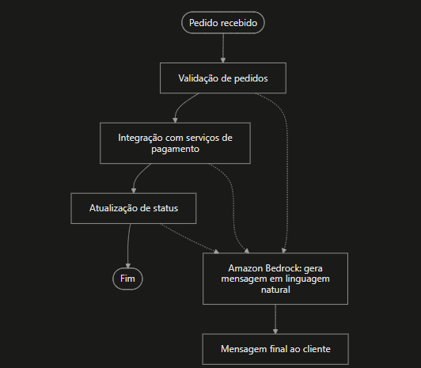

# desafioDIO-StepFunctions-Bedrock

O desafio proposto pede a orquestração de um fluxo de delivery usando o Step Functions e o Bedrock.

Para dar contexto, optei, como uma boa formiga cabeçuda (dizeres da minha mãe), por um delivery de doces que ao longo dos anos foi crescendo e sua base de clientes aumentou. O processo, que no início funcionava com os próprios funcionários da doceria respondendo às mensagens, e os vários sistemas separados de empresas diferentes deixaram de ser viáveis. Principalmente em épocas sazonais, como a Páscoa, nas quais há um grande aumento de pedidos, gerando grandes transtornos.

Mas, antes de entrar no fluxo do delivery em si, definirei alguns conceitos e seu uso.

## Step Functions

O Step Functions é um serviço da AWS que conecta serviços diferentes para que conversem entre si. Através do drag and drop (arrastar e soltar), é possível conectar esses serviços em um fluxograma visual, o que facilita o entendimento sobre as conexões e o tratamento de erros. A linguagem utilizada é a ASL (Amazon States Language), que se trata de uma espécie de JSON, na qual cada estado recebe um dado, faz seu trabalho e passa o resultado para o próximo.

## Quando faz sentido usar o Step Functions (e quando não)

Faz sentido quando os serviços já moram na AWS (Lambda, banco de dados, filas, notificações) e é preciso coordenar a ordem das etapas, repetir tentativas e tratar falhas.

Também faz sentido quando o produto está nascendo inteiro na nuvem.

Não faz sentido para uma empresa muito pequena, com poucos pedidos e um sistema simples. Nesse caso, um fluxo direto no código ou uma ferramenta mais simples custa menos e dá menos manutenção.

No caso do delivery da doceria, os vários sistemas de diferentes empresas não se mostram viáveis e, para atender a nova realidade do local, será criada uma arquitetura com vários serviços na nuvem AWS. Dessa forma, os serviços criados agora se comunicarão uns com os outros através do Step Functions.

## Amazon Bedrock no Step Functions

O Amazon Bedrock é uma plataforma com IAs generativas de diferentes modelos que você pode usar em seus sistemas.

O Step Functions precisa de permissão para chamar o Bedrock, e o modelo escolhido precisa estar disponível e liberado na região.

## Serviços Serverless

São serviços que poupam você de ter que configurar e gerenciar servidores, e oferecem a implementação na nuvem trazendo economia, pois só se paga de acordo com o uso.

Como dito anteriormente, em épocas como a Páscoa o volume de pedidos aumenta muito. Os serviços serverless (Lambda, SQS e DynamoDB sob demanda) escalam automaticamente, e o Step Functions coordena o fluxo sem virar gargalo.

## Construção do fluxo do delivery com Step Functions e Bedrock

O diagrama acima é uma simplificação do funcionamento. Os retângulos de "Validação de pedidos", "Integração com os serviços de pagamento" e "Atualização de status" são serviços com suas complexidades e regras fixas. O Step Functions conecta esses serviços, e a função do Amazon Bedrock é repassar o que está acontecendo de forma natural.

Diferentemente de um bot de regras, que só consegue responder caso o cliente digite algo previsto, ao usar o Amazon Bedrock o sistema consegue entender frases completas, como "Cadê meu pedido?" ou "Por que meu pedido não chegou?", e entregar uma resposta ao cliente. Um bot de regras só responderia se essa frase tivesse sido prevista. Por isso a IA se torna interessante nesses casos.

O Amazon Bedrock também entra quando os caminhos falham, como pagamento recusado ou pedido inválido. O Bedrock é útil justamente aí, para escrever o aviso ao cliente.

É importante entender que o Bedrock não decide nada sobre o pedido. Validação, cobrança e estorno seguem regras fixas, porque não faz sentido deixar um modelo de linguagem decidir sobre dinheiro. Ele só recebe o resultado já definido e escreve a mensagem.

Também é possível implementar um fluxo que não trava: ele segue um caminho alternativo. Se o pagamento é recusado, o Step Functions tenta de novo até duas vezes e, se continuar falhando, encerra o pedido e o Bedrock avisa o cliente. Se a cozinha recusa o pedido ou não responde, o pagamento é estornado e o cliente é avisado. Esse tratamento automático de erros e novas tentativas é uma das principais vantagens do Step Functions.

Além disso, para os casos de falha da IA, implementar um bot para que o cliente não fique sem resposta é outro caminho alternativo, deixando o sistema mais completo. Dessa forma, a doceria consegue focar nos outros serviços ou nos problemas mais complexos enquanto o sistema trabalha por ela nas situações mais rotineiras. O serverless, neste caso, serve muito bem para a Páscoa, pois escala automaticamente com a demanda, evitando perda de clientes.
